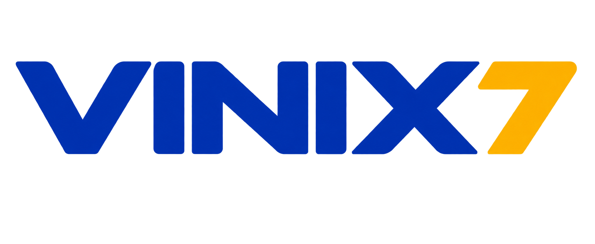

<p align="center">
  
</p>

# CodeCanvas — Sistem Web Micro-Quiz Interaktif VINIX7

**CodeCanvas** adalah platform evaluasi kompetensi mandiri berbasis web (*micro-quiz*) yang dirancang untuk peserta pelatihan pada **PT Vinix Seven Aurum (VINIX7)**. Aplikasi ini memfasilitasi evaluasi singkat lintas lima kategori kompetensi (**Tech, Business, Marketing, Finance, dan English**) dengan sistem penilaian otomatis serta terintegrasi dengan portal pembelajaran utama **VINIX7 LMS**.

**Live Demo:** [https://railway.app](https://railway.app)

---

## Fitur Utama

### 1. Ruang Peserta (Akses Publik Tanpa Login)
* **Katalog 5 Kategori Kompetensi:** Filter dinamis untuk bidang *Tech*, *Business*, *Marketing*, *Finance*, dan *English*.
* **Evaluasi Berbatas Waktu:** Penyajian satu soal pilihan ganda per layar dilengkapi hitung mundur otomatis **60 detik per soal** serta penguncian pilihan saat waktu habis.
* **Penilaian & Status Kesiapan Otomatis:** Perhitungan skor instan beserta predikat kesiapan belajar, pembahasan kunci jawaban, dan tautan lanjutan menuju **VINIX7 LMS**.
* **Antarmuka Responsif & Mode Ganda:** Mendukung peralihan tema **Mode Terang (*Light Mode*)** dan **Mode Gelap (*Dark Mode*)**.

### 2. Panel Manajemen Mentor (Terautentikasi)
* **Autentikasi Mentor:** Sistem masuk akun khusus tim mentor internal VINIX7 (akses melalui tautan *Portal Mentor* pada bagian footer).
* **Manajemen Paket Kuis & Bank Soal:** Tambah, kelola, dan hapus paket kuis beserta soal pilihan ganda.
* **Impor & Ekspor Berkas CSV:** Unggah bank soal secara massal menggunakan templat CSV terstandar dengan validasi otomatis serta unduh rekap hasil evaluasi peserta dalam format CSV.
* **Pengelolaan Riwayat:** Fitur penghapusan data hasil evaluasi secara satuan maupun massal.

---

## Teknologi yang Digunakan
* **Backend:** Laravel 12 (PHP 8.2+, Arsitektur MVC)
* **Frontend:** Blade Template, Tailwind CSS, Vite, Heroicons SVG
* **Basis Data:** SQLite (dapat disesuaikan ke MySQL/PostgreSQL melalui `.env`)

---

## Panduan Instalasi Lokal

1. **Kloning repositori:**
   ```bash
   git clone https://github.com
   cd codecanvas-vinix7
   ```
2. **Instal dependensi PHP dan aset frontend:**
   ```bash
   composer install
   npm install && npm run build
   ```
3. **Konfigurasi environment dan basis data SQLite:**
   ```bash
   cp .env.example .env
   php artisan key:generate
   touch database/database.sqlite
   php artisan migrate --seed
   ```
4. **Jalankan server lokal:**
   ```bash
   php artisan serve
   ```
   Akses aplikasi pada `http://127.0.0.1:8000`.

### Akun Demo Mentor Default
* **Email:** `admin@vinix7.id`
* **Kata Sandi:** `password`

---

## Informasi Proyek
Dikembangkan sebagai proyek akhir Kerja Praktek pada **Divisi Web Development — PT Vinix Seven Aurum (VINIX7)**.
